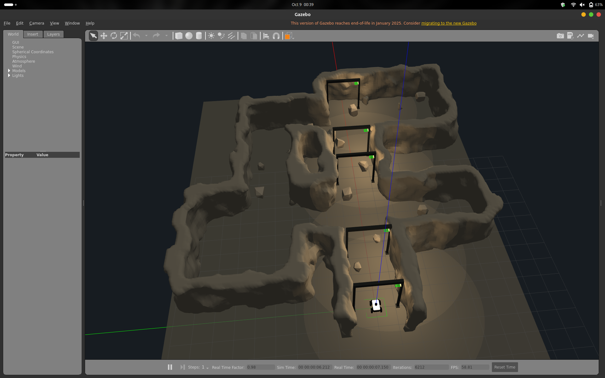
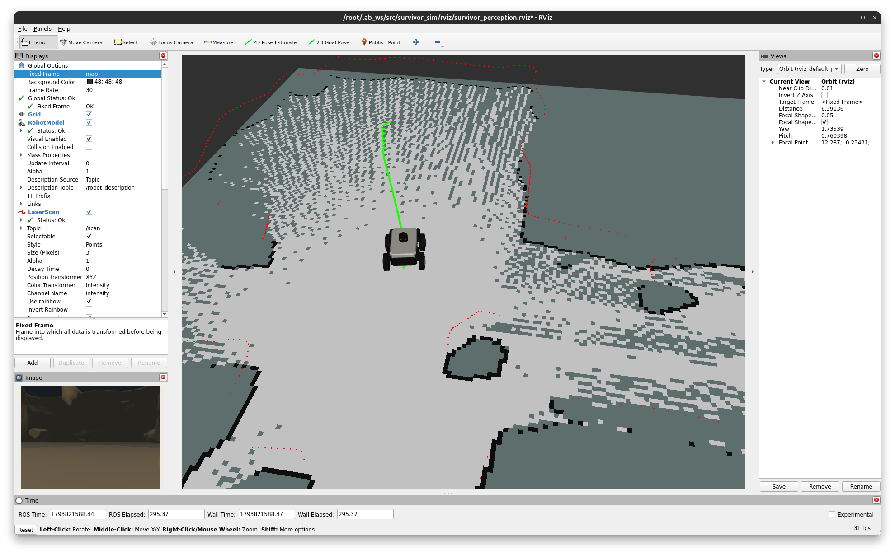
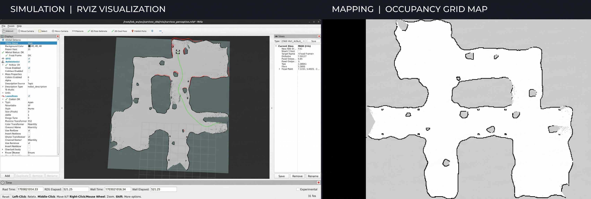

# SURVIVOR  
### Autonomous Underground Mine Exploration UGV

*Exploring the places humans shouldn't have to.*

SURVIVOR is a ROS 2-based simulation prototype of a four-wheel unmanned ground vehicle (UGV) designed to explore and map underground mine environments.

The idea is simple: send a robot into an unknown mine, let it explore using LiDAR, build a map of its surroundings, and navigate through the environment autonomously.

The project brings together a custom robot model, a simulated underground mine, SLAM, navigation, and frontier-based exploration.

This is the exploration and navigation stage of a larger mine-rescue concept. There's a lot more I'd like to build on top of it.

---

## The Simulation

The robot operates in a custom Gazebo mine environment featuring interconnected corridors, rooms, rocky walls, obstacles, and support structures.



## What can it do?

- **Explore:** Navigate through an initially unknown underground environment.
- **Map:** Build a 2D occupancy map using simulated 360° LiDAR and SLAM Toolbox.
- **Navigate:** Plan and execute paths using Nav2.
- **Find unexplored areas:** Use frontier-based exploration to identify unknown regions and send navigation goals.
- **Visualise:** Monitor the robot, LiDAR scans, map, navigation path, and exploration frontiers in RViz.
- **Save maps:** Export the generated occupancy map for later navigation.

The robot also includes a simulated RGB camera for visualisation and future perception work. The current SLAM pipeline is LiDAR-based.

---

## Mapping & Exploration

Here's what the mapping process looks like in RViz, alongside the final exported occupancy map.



The robot uses LiDAR measurements and odometry to progressively build a map while moving through the mine.



The left side shows the completed map in RViz, with the robot and navigation path. The right side shows the 2D occupancy grid exported from the SLAM session.

---

## How it works

The system combines simulation, perception, mapping, and navigation.

```text
                   Gazebo
             Robot + Mine World
                     |
              Simulated Sensors
                     |
              LiDAR + Odometry
                     |
                SLAM Toolbox
                     |
                 2D Map
                     |
                   Nav2
                     |
            Frontier Exploration
                     |
             Navigation Goals
                     |
                Robot Moves
                     |
              Map Gets Updated
```

### Technology stack

| Component | Technology |
|---|---|
| Middleware | ROS 2 Humble |
| Simulation | Gazebo Classic |
| Robot description | URDF, STL meshes, Gazebo ROS plugins |
| Environment | SDF worlds and Gazebo models |
| Mapping | SLAM Toolbox |
| Navigation | Nav2 |
| Saved-map localisation | AMCL |
| Autonomous exploration | `explore_lite` |
| Visualisation | RViz2 |
| Build system | Colcon, `ament_python` |
| Configuration | Python launch files, YAML |

### A few important ROS interfaces

| Topic / Interface | Purpose |
|---|---|
| `/scan` | Simulated LiDAR measurements |
| `/camera/image_raw` | RGB camera images |
| `/odom` | Robot odometry |
| `/cmd_vel` | Velocity commands |
| `/joint_states` | Wheel joint states |
| `/map` | Occupancy map |
| `/tf`, `/tf_static` | Coordinate transforms |
| `/navigate_to_pose` | Nav2 navigation action |
| `/explore/frontiers` | Exploration frontier markers |
| `/explore/resume` | Pause/resume exploration input |

The main transform chain is:

```text
map → odom → base_footprint → base_link
```

---

# Getting Started

## 1. Requirements

The project was developed with:

- Ubuntu 22.04
- ROS 2 Humble
- Gazebo Classic
- Python 3
- Colcon

Required ROS packages:

- `gazebo_ros`
- `gazebo_plugins`
- `robot_state_publisher`
- `slam_toolbox`
- `nav2_bringup`
- `nav2_map_server`
- `rviz2`
- `teleop_twist_keyboard`
- `explore_lite`

My development setup used an Ubuntu 22.04 container running on an Ubuntu 24.04 host. If you're using Docker, make sure Gazebo and RViz GUI forwarding is configured.

## 2. Create the workspace

```bash
mkdir -p ~/lab_ws/src
cd ~/lab_ws/src
```

Clone the project:

```bash
git clone https://github.com/sreeragkz/Survivor-Autonomous-UGV-for-navigating-Underground-mines.git survivor_sim
```

Clone the exploration dependency:

```bash
git clone https://github.com/robo-friends/m-explore-ros2.git
```

Install its dependencies:

```bash
source /opt/ros/humble/setup.bash

cd ~/lab_ws

rosdep install --from-paths src/m-explore-ros2/explore \
  src/m-explore-ros2/explore_lite_msgs \
  --ignore-src -r -y
```

## 3. Build the workspace

```bash
cd ~/lab_ws

colcon build
source install/setup.bash
```

In every new terminal, source the ROS environment:

```bash
source /opt/ros/humble/setup.bash
source ~/lab_ws/install/setup.bash
```

> **Important:** The package installation configuration must include the launch files, URDF, meshes, worlds, and the complete recursive `models/` directory. Rebuild after changing these assets.

---

# Running the Simulation

## 1. Launch the mine and robot

```bash
ros2 launch survivor_sim mine_natural.launch.py \
  world_file:=mine_natural_open.sdf
```

This launches Gazebo, loads the selected mine environment, and spawns the robot near the entrance.

For the enclosed mine environment:

```bash
ros2 launch survivor_sim mine_natural.launch.py \
  world_file:=mine_natural_roof.sdf
```

## 2. Start SLAM

In a new terminal:

```bash
ros2 launch slam_toolbox online_async_launch.py \
  use_sim_time:=true
```

SLAM Toolbox processes the LiDAR scans and odometry to build the occupancy map.

## 3. Open RViz

```bash
rviz2 --ros-args -p use_sim_time:=true
```

Set the **Fixed Frame** to `map`.

Useful displays:

- Map — `/map`
- LaserScan — `/scan`
- RobotModel — `/robot_description`
- TF

## 4. Teleoperate the robot

In another terminal:

```bash
ros2 run teleop_twist_keyboard teleop_twist_keyboard \
  --ros-args -p speed:=0.20 -p turn:=0.40
```

Drive through the corridors and rooms while observing the map update in RViz.

## 5. Save the map

While SLAM is running:

```bash
mkdir -p ~/lab_ws/maps

ros2 run nav2_map_server map_saver_cli \
  -f ~/lab_ws/maps/mine_map \
  --ros-args -p use_sim_time:=true -p save_map_timeout:=10.0
```

This generates:

- `mine_map.pgm` — the occupancy map.
- `mine_map.yaml` — map metadata.

Keep both files together.

---

# Autonomous Exploration

This is where things get interesting.

Instead of manually driving the robot through the mine, we can let it explore using **frontier-based exploration**.

The explorer identifies boundaries between known free space and unknown space, selects candidate frontiers, and sends navigation goals to Nav2. The robot moves towards these goals while SLAM continues updating the map.

## 1. Start a fresh simulation

Restart Gazebo with the roofed mine:

```bash
ros2 launch survivor_sim mine_natural.launch.py \
  world_file:=mine_natural_roof.sdf
```

## 2. Start live SLAM

```bash
ros2 launch slam_toolbox online_async_launch.py \
  use_sim_time:=true
```

## 3. Start Nav2

```bash
ros2 launch nav2_bringup navigation_launch.py \
  params_file:="$HOME/lab_ws/src/survivor_sim/config/nav2.yaml" \
  use_sim_time:=true autostart:=true use_composition:=false
```

This starts the navigation servers against the live SLAM map.

**Don't launch saved-map navigation at the same time.** In this mode, SLAM is responsible for publishing the map and the `map → odom` transform.

## 4. Open RViz

```bash
rviz2 --ros-args -p use_sim_time:=true
```

Set the Fixed Frame to `map`.

Add the Map, LaserScan, RobotModel, and TF displays. You can also add a MarkerArray display on `/explore/frontiers` to visualise candidate exploration points.

## 5. Start frontier exploration

```bash
ros2 run explore_lite explore --ros-args \
  -p use_sim_time:=true \
  -p robot_base_frame:=base_footprint \
  -p costmap_topic:=/map \
  -p costmap_updates_topic:=/map_updates \
  -p visualize:=true \
  -p planner_frequency:=0.5 \
  -p progress_timeout:=45.0 \
  -p min_frontier_size:=0.5 \
  -p return_to_init:=true
```

The explorer selects frontier goals and delegates navigation to Nav2.

A few useful parameters:

| Parameter | Purpose |
|---|---|
| `planner_frequency` | How often frontier goals are reconsidered |
| `progress_timeout` | How long a goal can remain without progress |
| `min_frontier_size` | Filters out small frontier candidates |
| `return_to_init` | Attempts to return to the pose where exploration started |

You can pause and resume exploration:

```bash
# Pause
ros2 topic pub --once /explore/resume \
  std_msgs/msg/Bool "{data: false}"

# Resume
ros2 topic pub --once /explore/resume \
  std_msgs/msg/Bool "{data: true}"
```

Save the autonomous map while SLAM is still running:

```bash
ros2 run nav2_map_server map_saver_cli \
  -f ~/lab_ws/maps/mine_autonomous \
  --ros-args -p use_sim_time:=true -p save_map_timeout:=10.0
```

> Exploration stopping means that no eligible frontier goals remain. It does not necessarily mean every reachable part of the mine has been mapped. The current environment also does not enforce a boundary preventing exploration goals outside the mine.

---

# Navigating with a Saved Map

Once a map has been saved, it can be reused for navigation.

Stop SLAM Toolbox, exploration, teleoperation, and any previously running Nav2 instance.

Start saved-map navigation:

```bash
ros2 launch nav2_bringup bringup_launch.py \
  slam:=false \
  map:="$HOME/lab_ws/maps/mine_map.yaml" \
  params_file:="$HOME/lab_ws/src/survivor_sim/config/nav2.yaml" \
  use_sim_time:=true autostart:=true use_composition:=false
```

In RViz:

1. Set the Fixed Frame to `map`.
2. Use **2D Pose Estimate** to set the robot's initial position and heading.
3. Check that the LiDAR scan aligns with the map.
4. Use **Nav2 Goal** to send a navigation target.

You can also add a Path display on `/plan` to visualise the global route.

---

# Things I Learned

Getting a robot to move in Gazebo is one thing. Getting simulation, sensors, mapping, transforms, and navigation to work together is another.

Some of the challenges I worked through:

- **Mapping distortion:** Initial encoder-based odometry tests produced distortion, particularly while turning. The current demonstration uses ideal Gazebo world odometry instead.
- **Robot spawning:** Worked through URDF parsing and Gazebo model-spawning issues.
- **Model and mesh loading:** Debugged resource paths and asset installation so Gazebo and RViz could load the robot and mine correctly.
- **TF and localisation:** Worked through transform-chain issues and the interaction between SLAM, odometry, and Nav2.
- **Navigation integration:** Brought together live SLAM, Nav2, and frontier exploration without conflicting map or transform publishers.

These were useful lessons in debugging a complete ROS 2 system rather than treating each package as an isolated component.

---

# Current Limitations & What's Next

This is a simulation prototype, not a field-ready mine-rescue robot.

The current demonstration:

- Uses ideal Gazebo world odometry rather than realistic wheel encoder and IMU fusion.
- Has not been validated on a physical robot.
- Does not yet implement thermal imaging or survivor detection.
- Does not simulate communication loss or motor faults.
- Does not enforce a mine exploration boundary.
- Does not include quantitative coverage or reliability benchmarks.

### Planned extensions

- Encoder and IMU fusion with realistic noise and wheel slip.
- Motor and encoder fault injection.
- Communication degradation, packet loss, and latency simulation.
- Thermal sensing and survivor detection.
- Mission supervision, exploration boundaries, and automatic map saving.
- Quantitative evaluation of coverage, completion time, failed goals, collisions, and return success.
- Hardware testing and further simulator development.

---

# Repository Structure

```text
lab_ws/
├── src/
│   ├── survivor_sim/
│   │   ├── launch/
│   │   ├── urdf/
│   │   ├── meshes/
│   │   ├── worlds/
│   │   ├── models/
│   │   ├── config/
│   │   ├── package.xml
│   │   └── setup.py
│   │
│   └── m-explore-ros2/
│
└── maps/
```

The Gazebo models contain their own model descriptions and mesh assets. The roof is a separate static model included by the roofed world.

---

# Acknowledgements

This project builds on several excellent open-source tools:

- [ROS 2 Humble](https://docs.ros.org/en/humble/)
- [Gazebo Classic](https://classic.gazebosim.org/)
- [SLAM Toolbox](https://github.com/SteveMacenski/slam_toolbox)
- [Nav2](https://github.com/ros-navigation/navigation2)
- [m-explore-ros2](https://github.com/robo-friends/m-explore-ros2)

The underlying SLAM, localisation, navigation, and frontier exploration algorithms are provided by these existing packages. My work focused on integrating them with the custom robot and mine simulation, configuring the system, debugging the pipeline, and demonstrating the complete workflow.

---

**Built by Sreerag KS**  
Mechatronics Engineering | Robotics | ROS 2

*Still a work in progress. The goal is to make the robot a little more capable with every iteration.*